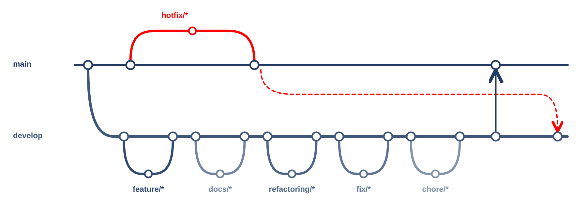

# 캠퍼스 클라이언트

서경대학교 캠퍼스 길찾기 사용자 앱입니다.

## 개발 목적

건물 밖에서 강의실 앞까지, 층과 층 사이를 잇는 캠퍼스 길 안내를 휴대폰에서 제공합니다.
실제 캠퍼스를 3D로 보여 주고, 장소 검색·자연어 요청·경로 안내·현재 위치(이미 만든 통로로 끌어당겨 표시)를 기기 안에서 처리해 인터넷이 약해도 쓸 수 있게 합니다.

## 사용 도구

| 구분       | 도구                                                                                        |
| ---------- | ------------------------------------------------------------------------------------------- |
| 앱         | React Native, Expo(개발 빌드), expo-router, TypeScript                                      |
| 3D 지도    | expo-gl, three.js (캠퍼스 모델을 glTF 로 내보내 기기에서 그림), 대체로 react-native-webview |
| 센서·위치  | expo-location, expo-sensors(기압·걸음)                                                      |
| 기기 안 AI | 규칙 기반 자연어 조건 추출, 위치 보정 모델(TS), llama.rn(Gemma 270M, 실험)                  |
| UI         | react-native-reanimated, react-native-gesture-handler, expo-blur, lucide-react-native       |
| 품질       | vitest, ESLint, Prettier, simple-git-hooks, GitHub Actions                                  |
| 대상 기기  | Android(갤럭시 S21 이상 기준, 구형 등급별 지원), iOS 는 같은 코드로 빌드                    |

## 브랜치와 PR

- `main`: 배포용. 일반 변경은 PR로 병합.
- `develop`: 개발 통합용.
- `feature/*`, `docs/*`, `refactoring/*`, `fix/*`, `chore/*`: `develop`에서 분기 → 작업·검증 → PR → `develop` 병합.
- 배포 준비 완료 후 `develop` → `main` PR.
- `hotfix/*`: `main`에서 분기 → 검증 → PR 없이 `main` 병합·push. 같은 수정을 `develop`에도 반영.

PR은 목적·변경·확인·배포/후속을 각각 한 줄로 적습니다. 미검증은 이유를 적고, 배포 영향이나 후속 작업이 없으면 `없음`을 적습니다.

실행 방법과 개발 세부 내용은 [개발 가이드](docs/개발-가이드.md)에 있습니다.
